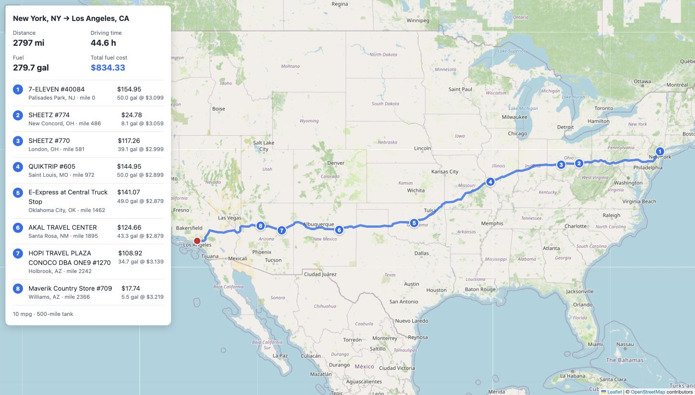

# Fuel Route Optimizer

A Django REST API that plans a driving route between two US locations and picks the most cost-effective places to refuel along the way, for a vehicle with a **500-mile range** that gets **10 miles per gallon**.

```
GET /api/v1/route-plan/?start=New York, NY&finish=Los Angeles, CA
```

returns the route, where to stop and how much fuel to buy at each stop, the total fuel cost, and a link to the route on a map.



- **One routing API call per new trip**, none for a trip planned before (cached).
- **Fast:** about 1–1.5 s for a new cross-country trip (almost all of it the routing call), 10–60 ms when cached.
- **Cost-effective:** a greedy fuel-stop algorithm that a test proves optimal against brute force.

## Contents

- [Quick start](#quick-start)
- [API](#api)
- [How it works](#how-it-works)
- [Assumptions](#assumptions)
- [Design decisions](#design-decisions)
- [Performance](#performance)
- [Testing](#testing)
- [Project structure](#project-structure)
- [Data](#data)
- [Limitations and next steps](#limitations-and-next-steps)

## Quick start

Requirements: Python 3.12+ and a free [OpenRouteService](https://openrouteservice.org/dev/#/signup) API key.

```bash
python3 -m venv .venv
source .venv/bin/activate
pip install -r requirements.txt

cp .env.example .env                  # then set DJANGO_SECRET_KEY and ORS_API_KEY
python manage.py migrate
python manage.py load_towns           # ~166k US town centers (one-time, a few seconds)
python manage.py load_fuel_stations   # fuel stations + prices, placed at their town
python manage.py runserver
```

Then open <http://127.0.0.1:8000/api/v1/route-plan/?start=Chicago,%20IL&finish=Denver,%20CO>, or the map at <http://127.0.0.1:8000/api/v1/route-plan/map/?start=Chicago,%20IL&finish=Denver,%20CO>.

**Postman:** import [`postman/fuel-route-optimizer.postman_collection.json`](postman/fuel-route-optimizer.postman_collection.json). It has example trips and error cases with tests; successful trips show a summary table in the **Visualize** tab.

## API

### `GET /api/v1/route-plan/`

| Query parameter | Example | Notes |
|---|---|---|
| `start` | `Chicago, IL` | A US town as `City, ST` (or a full state name: `chicago, illinois`), or coordinates as `lat,lng` |
| `finish` | `Denver, CO` | Same formats |

Response (Chicago → Denver; route coordinates and stops shortened):

```json
{
  "start": {"label": "Chicago, IL", "lat": 41.850033, "lng": -87.6500523},
  "finish": {"label": "Denver, CO", "lat": 39.7391536, "lng": -104.9847034},
  "distance_miles": 1003.3,
  "duration_hours": 15.9,
  "fuel_summary": {
    "miles_per_gallon": 10,
    "tank_range_miles": 500,
    "total_gallons": 100.33,
    "total_cost_usd": 292.12,
    "starts_with_full_tank": false
  },
  "fuel_stops": [
    {
      "stop_number": 1,
      "station_id": 70180,
      "name": "Gulf",
      "address": "SR-83",
      "city": "Bensenville",
      "state": "IL",
      "lat": 41.9550296,
      "lng": -87.9400657,
      "route_mile": 0.0,
      "price_per_gallon": 3.059,
      "gallons": 20.3,
      "cost_usd": 62.1
    },
    {
      "stop_number": 2,
      "station_id": 67395,
      "name": "KUM & GO #0267",
      "address": "I-80, EXIT 267 & SR 38",
      "city": "Tipton",
      "state": "IA",
      "route_mile": 203.0,
      "price_per_gallon": 2.982,
      "gallons": 26.2,
      "cost_usd": 78.14,
      "...": "..."
    }
  ],
  "route": {"type": "LineString", "coordinates": [[-87.6501, 41.85003], [-87.64984, 41.85238], "..."]},
  "map_url": "http://127.0.0.1:8000/api/v1/route-plan/map/?start=Chicago%2C+IL&finish=Denver%2C+CO"
}
```

- `fuel_stops` are in driving order; `route_mile` is how far along the route each stop is.
- `route` is GeoJSON (`[lng, lat]` pairs), thinned to at most 1,000 points to keep responses small (~20 KB).
- `total_cost_usd` is the sum of the stops' `cost_usd`.

### `GET /api/v1/route-plan/map/`

Same parameters; returns an HTML page that draws the route and numbered fuel stops (Leaflet + OpenStreetMap). It reuses the cached route, so it makes no routing API call.

### Errors

Every error has the same shape:

```json
{"error": {"code": "invalid_location", "message": "Could not find \"Atlantis, IL\". Check the spelling, or pass coordinates as \"lat,lng\"."}}
```

| Status | `code` | When |
|---|---|---|
| 400 | `invalid_request` | `start` or `finish` missing |
| 400 | `invalid_location` | Unknown town, coordinates outside the USA, or latitude/longitude swapped (the message suggests the fix) |
| 405 | `method_not_allowed` | Anything but `GET` |
| 422 | `no_route` | The routing service found no drivable route |
| 422 | `no_fuel_plan` | A stretch longer than 500 miles has no known fuel station; the message says between which miles |
| 502 / 503 / 504 | `routing_failed` / `routing_unavailable` / `routing_timeout` | The routing service failed, is rate-limited or unconfigured, or timed out |

## How it works

**Once, at setup:** the fuel price list has addresses like `I-44, EXIT 283 & US-69` but no coordinates. `load_towns` and `load_fuel_stations` place each station at the center of its town using public-domain US Census and USGS data (see [Data](#data)). Doing this ahead of time is what keeps requests fast and free of geocoding calls.

**On each request** ([`planner/services/trip_planner.py`](planner/services/trip_planner.py)):

1. **Resolve start and finish** from the local town table (`"Chicago, IL"` → coordinates). Bad input is rejected here, before any API call.
2. **Get the route** from OpenRouteService: **one call**, cached for 24 hours.
3. **Find stations along the route** ([`station_search.py`](planner/services/station_search.py)): resample the route to one point per mile, query the stations inside its bounding box, and measure each one's distance to the route with a KD-tree. Keep those within 10 miles, with their mile marker, and only the cheapest in each 25-mile stretch.
4. **Choose fuel stops** ([`fuel_planner.py`](planner/services/fuel_planner.py)). The tank starts empty and is filled at the cheapest station near the start. Then, at each station:
   1. If a **cheaper** station is within range, buy just enough fuel to reach it.
   2. Otherwise, if the finish is within range, buy just enough to finish.
   3. Otherwise, fill the tank and drive to the cheapest station within range.

   This is the cheapest possible plan: fuel is never carried past a cheaper station, and when everything in reach is pricier, filling up buys as much cheap fuel as the tank holds. A test compares it with a brute-force search on 200 random routes.

   Saving a cent or two isn't worth an extra stop, so a station must be at least **5¢/gal cheaper** (`MIN_SAVING_PER_GALLON`) to count as cheaper. On New York → Los Angeles this gives 8 stops for $834 instead of 11 stops for $832. Set it to `0` for the strictly cheapest plan.

## Assumptions

- The tank **starts empty** and is filled at the cheapest station within 25 miles of the start, so every gallon of the trip is paid for and the total is the real trip cost. If no station is that close, the trip starts with a full tank (`starts_with_full_tank: true`).
- The vehicle arrives at the finish with an empty tank.
- A station is "on the way" if it's within 10 miles of the route. The short detour to reach it isn't added to the fuel needed.
- Stations are placed at the center of their town (the price list has no coordinates), which is accurate to a few miles.
- When a station is listed more than once with different prices, the lowest price is used.
- All tuning values live in one commented section of [`config/settings.py`](config/settings.py).

## Design decisions

| Decision | Why | Trade-off |
|---|---|---|
| Place stations and towns once at setup, from local files | Requests need no geocoding: one routing call is the only external call | Town-level accuracy (a few miles) instead of exact addresses |
| Start/finish as `City, ST` or `lat,lng` | Resolved locally, so no geocoding API call | Street addresses aren't supported |
| OpenRouteService for routing | Free, reliable, returns the full route geometry in one call | Needs a free API key with a daily request quota; caching keeps repeat trips from using it |
| Cache routes (Django cache, 24 h) | Repeat trips and the map page cost no API call | Local-memory cache per process; point `CACHES` at Redis to share it |
| Greedy fuel planner, plain Python | Optimal, easy to read, fully unit-tested without Django | — |
| KD-tree to find stations near the route | ~20,000 route points × thousands of stations in milliseconds | Adds SciPy |
| SQLite, no PostGIS | Clone and run with no database setup | Spatial queries are done in Python (fast enough at this size) |
| Thin views, logic in `planner/services/` | Each module has one job and its own tests | — |

## Performance

Measured locally with real data and the real routing API, starting from an empty cache:

| Trip | Distance | First request | Cached | Stops | Fuel cost |
|---|---|---|---|---|---|
| New York, NY → Los Angeles, CA | 2,797 mi | 1.45 s | 24 ms | 8 | $834.33 |
| Seattle, WA → Miami, FL | 3,319 mi | 1.42 s | 63 ms | 15 | $1,009.14 |
| Atlanta, GA → Phoenix, AZ | 1,853 mi | 1.23 s | 14 ms | 5 | $536.59 |
| Chicago, IL → Denver, CO | 1,003 mi | 1.06 s | 11 ms | 4 | $292.12 |
| Dallas, TX → Houston, TX | 240 mi | 0.76 s | 7 ms | 1 | $66.19 |

Most of a first request is the routing call; everything else (station search and fuel planning) takes about 30 ms even coast to coast.

## Testing

```bash
pip install -r requirements-dev.txt
python manage.py test   # 130 tests, under a second; the routing API is mocked
ruff check .            # lint
ruff format --check .   # formatting
```

Highlights:

- **The fuel planner matches a brute-force search** on 200 random routes. Breaking any of its three rules makes that test fail.
- **API tests check that a new trip makes exactly one routing call, and a repeat makes none.**
- Data tests use real rows from the Census and USGS files (San Francisco, Honolulu, same-named towns in one county, and more).

GitHub Actions runs lint, formatting, a missing-migrations check and the tests on Python 3.12 and 3.14 for every push and pull request.

## Project structure

```
config/                     Django project: settings (from environment variables), URLs
planner/
├── models.py               Town, FuelStation
├── services/               The logic, one job per module
│   ├── trip_planner.py     Ties everything together for one trip
│   ├── locations.py        "City, ST" / "lat,lng" → coordinates
│   ├── routing.py          OpenRouteService client + cache
│   ├── station_search.py   Stations along the route (KD-tree)
│   ├── fuel_planner.py     Where to buy fuel, and how much (plain Python)
│   ├── geo.py              Distances along the Earth's surface
│   └── place_names.py      Matching "St. Louis" with "Saint Louis", state names
├── api/                    Serializers, views, URLs, error handling
├── management/commands/    build_towns_file, load_towns, load_fuel_stations
├── templates/planner/      The map page
└── tests/
data/                       fuel_prices.csv, us_towns.csv
postman/                    Postman collection
```

## Data

| File | What it is |
|---|---|
| `data/fuel_prices.csv` | The provided list of truck stops and their retail fuel prices |
| `data/us_towns.csv` | ~166k US towns with the coordinates of their center, built from two public-domain sources (below) |

The fuel price list has addresses but no coordinates, so each station is placed at the center of its town. Doing this once at setup means API requests never need a geocoding call. 99.5% of US stations are placed; the rest are in places too small for either source (run `load_fuel_stations -v 2` to list them).

**Where town centers come from**

- The [US Census Gazetteer](https://www.census.gov/geographies/reference-files/time-series/geo/gazetteer-files.html) lists every official town, but its point is a geometric "internal point" that can be far from downtown. San Francisco's is in the Pacific, because the city limits include ocean.
- [USGS Geographic Names](https://www.usgs.gov/us-board-on-geographic-names/domestic-names) gives the traditional center of every populated place. Each Census town moves to the USGS center with the same name in the same county, as long as the move is plausible for the town's size. USGS places missing from the Census list (e.g. Breezewood, PA) are added when their name is unique in their state.

To rebuild `data/us_towns.csv`, download into `data/raw/` the 2025 "Places" and "County Subdivisions" national Gazetteer files and the USGS [`DomesticNames_National_Text.zip`](https://prd-tnm.s3.amazonaws.com/StagedProducts/GeographicNames/DomesticNames/DomesticNames_National_Text.zip), then run:

```bash
python manage.py build_towns_file \
    --places data/raw/2025_Gaz_place_national.txt \
    --cousubs data/raw/2025_Gaz_cousubs_national.txt \
    --usgs data/raw/Text/DomesticNames_National.txt
```

## Limitations and next steps

- **Coverage of the price list.** Some regions have few stations. California has only 8, all in the far south-east, so a trip like San Francisco → Las Vegas has a 536-mile stretch with no known station and returns a clear `no_fuel_plan` error.
- **Shared cache.** The default cache is per process. With several server processes, point `CACHES` at Redis so a route fetched by one is reused by all.
- **Street addresses.** Supporting them would need a geocoding call per request (still within 3 external calls).
- **Production hardening** (HTTPS settings, rate limiting, a production server such as Gunicorn) is out of scope here.
